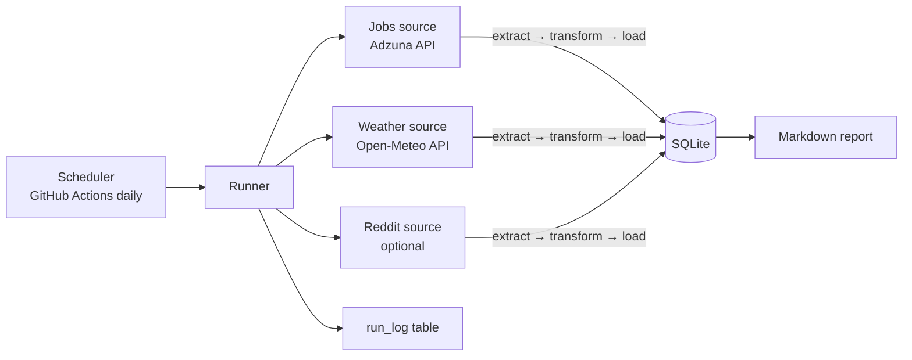

# Automated API Data Collector: Data Job Market Tracker

A Python pipeline that collects data from several public APIs every day, cleans it, and stores it in a database, with no manual steps. The main source tracks the US job market for data roles: which skills employers ask for, what they pay, where the jobs are, and how often postings mention visa sponsorship.

**Skills shown:** REST APIs and OAuth, extract-transform-load design, idempotent upserts, retries and failure isolation, secrets handling, scheduling with GitHub Actions, offline tests with mocked APIs, CI.

## Sources

| Source | What it collects | Key needed |
|---|---|---|
| **Adzuna** (job postings) | Data analyst, data engineer, BI analyst and analytics engineer postings, tagged with 21 skills and sponsorship language | Free key |
| **Open-Meteo** (weather) | Daily weather for Ames, Des Moines and Chicago | None |
| **Reddit** (optional) | New posts from data-career subreddits | Reddit API approval; skipped until configured |

## Key findings

> Fill in after a few weeks of collection (`python -m collector report`). Example format:
> - **SQL appears in X% of data analyst postings, ahead of Python (Y%).** SQL is the skill to prioritize for analyst roles.
> - **Z% of postings say they won't sponsor visas.**

- 
- 
- 

## How it works



- **One pattern for every source.** Each source is a class with `extract`, `transform` and `load`. Adding an API means writing one new file; the runner, logging and scheduling work for it automatically.
- **Idempotent loads.** Every write is an upsert keyed on the record's ID, so running twice in a day never duplicates data. `first_seen_at` is kept and `last_seen_at` updates, which shows how long postings stay open.
- **Failure isolation.** Each source runs separately. If one API is down, the others still load, and every attempt is recorded in `run_log` as success, failed or skipped.
- **Retries.** HTTP calls retry with exponential backoff on timeouts and on 429/5xx errors.
- **Secrets stay secret.** Keys come from environment variables or GitHub Secrets, and error messages are scrubbed so keys never reach logs.
- **Weather history self-corrects.** Each run fetches the past two days plus today. Today's forecast is overwritten by the observed value on the next run.

## Quick start

```bash
pip install -r requirements.txt
cp .env.example .env              # add your free Adzuna key
python -m collector run           # collect now
python -m collector report        # writes reports/latest.md
python -m collector status        # recent runs
```

Weather works without any key, so `python -m collector run --source weather` is a quick first test.

Running it daily (GitHub Actions, cron or Windows Task Scheduler) is covered in [`docs/SETUP.md`](docs/SETUP.md). How each part works, and interview prep, is in [`docs/WALKTHROUGH.md`](docs/WALKTHROUGH.md).

## Tests

```bash
pip install -r requirements-dev.txt
python -m pytest -v
```

The tests run fully offline: HTTP calls are intercepted and answered with sample payloads shaped like the real APIs. They cover deduplication, rerunning without duplicates, skill and sponsorship tagging, a failing API not stopping the others, secret redaction, and the optional Reddit source.

## Data model

- `job_postings`: one row per posting, with salary, location, flags and first/last seen dates
- `job_skills`: one row per (posting, skill)
- `weather_daily`: one row per (city, date)
- `reddit_posts`: one row per post (no usernames stored)
- `run_log`: one row per source per run

## Limitations

- Adzuna returns a description **snippet**, not the full posting, so skill and sponsorship tags undercount. Treat them as directional.
- The sponsorship flags are keyword-based. "Unable to sponsor" is caught; unusual wording may not be.
- Adzuna's free tier allows 250 calls a day. The default setup uses about 8.

## Data sources and terms

Job data from [Adzuna](https://www.adzuna.com), credited per their terms. Raw postings are not committed to this repo. Weather from [Open-Meteo](https://open-meteo.com) (CC BY 4.0).
